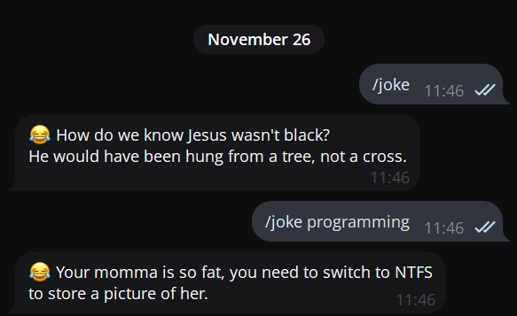

# it-incubator-01-homework-tg-bot

## Architecture

The backend is organized into presentation, application, and adapter modules. Each module exposes one main object literal and imports the objects it uses directly. The project does not use application classes, factories, or dependency injection. As a result, application use cases depend directly on their API adapters.

- `src/presentation` contains the Hono app and HTTP routes.
- `src/application` contains bot command behavior, Telegram update handling, and use cases. It does not depend on Hono, but use cases import the corresponding API adapters directly.
- `src/adapters` contains integrations with Telegram and other external services.
- `src/index.mjs` starts the server and registers the Telegram webhook; application objects call adapter objects directly.

## Bot commands

- `GET /start` returns the greeting.
- `GET /convert?amount=10&from=USD&to=EUR` converts currencies using Frankfurter reference rates.
- `GET /weather?city=Istanbul` returns current weather from Open-Meteo.
- `GET /joke` fetches a safe-mode joke from JokeAPI through the application layer and returns it as JSON.
- `GET /joke?category=Programming` requests a joke by category. Supported categories are `Any`, `Programming`, `Misc`, `Dark`, `Pun`, `Spooky`, and `Christmas`.
- `GET /dog` returns a random dog image URL from Dog CEO.
- In Telegram, use `/convert 10 USD EUR` to convert currencies, `/weather Istanbul` for current weather, `/joke` and `/joke Programming` for jokes, or `/dog` to receive a random dog photo. `/help` lists the supported bot commands.
- Telegram sends updates to `POST /telegram/webhook`. At startup the app registers `TELEGRAM_WEBHOOK_URL` with Telegram, defaulting to `https://desktop-7m4fs3b.tail7506bd.ts.net`. The endpoint verifies Telegram's secret header. Unknown commands and ordinary text receive a prompt to use `/help`. The bot token is imported from the ignored `token.mjs` file as `TELEGRAM_BOT_TOKEN`.

### Joke command examples

The screenshot below shows the bot responses to `/joke` and `/joke` with a category.

The HTTP routes expose command responses as JSON, while Telegram messages arrive through the webhook endpoint. Weather, currency, joke, and dog use cases call their respective external API clients directly.

JokeAPI was selected because its public v2 API provides categorized jokes, supports single-part and setup/delivery formats, and offers safe mode without requiring an API key.

## Architecture diagram

PlantUML source: [docs/c4/03-component.puml](docs/c4/03-component.puml).
