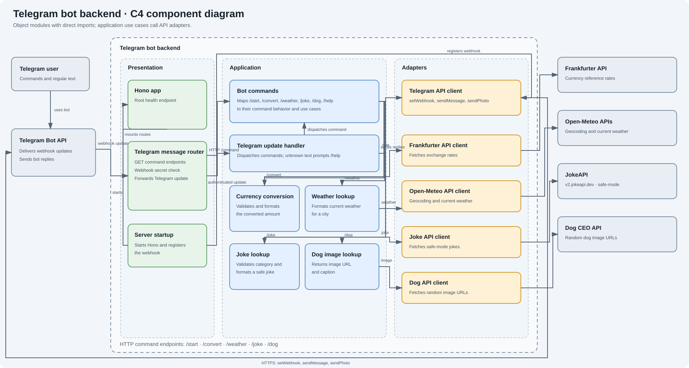

# it-incubator-01-homework-tg-bot

## Architecture

The backend uses a three-layer architecture. Dependencies point inward from the presentation layer to application use cases. Adapters provide integrations with external systems and are wired at the application entry point.

- `src/presentation` contains the Hono app and HTTP routes.
- `src/application` contains bot command behavior and use cases, independent of Hono and external services.
- `src/adapters` contains integrations with Telegram and other external services.
- `src/index.mjs` is the composition root that wires the layers and starts the server.

## Bot commands

- `GET /start` returns the greeting.
- `GET /convert?amount=10&from=USD&to=EUR` converts currencies using Frankfurter reference rates.
- `GET /weather?city=Istanbul` returns current weather from Open-Meteo.
- `GET /joke` fetches a safe-mode joke from JokeAPI through the application layer and returns it as JSON.
- `GET /joke?category=Programming` requests a joke by category. Supported categories are `Any`, `Programming`, `Misc`, `Dark`, `Pun`, `Spooky`, and `Christmas`.
- In Telegram, use `/convert 10 USD EUR` to convert currencies, `/weather Istanbul` for current weather, or `/joke` and `/joke Programming` for jokes. `/help` lists the supported bot commands.
- Telegram sends messages to `POST /telegram/webhook`. At startup the app registers `TELEGRAM_WEBHOOK_URL` with Telegram, defaulting to `https://desktop-7m4fs3b.tail7506bd.ts.net`. The endpoint verifies Telegram's secret header. The bot token is imported from the ignored `token.mjs` file as `TELEGRAM_BOT_TOKEN`.

The HTTP routes expose command responses as JSON, while Telegram messages arrive through the webhook endpoint.

JokeAPI was selected because its public v2 API provides categorized jokes, supports single-part and setup/delivery formats, and offers safe mode without requiring an API key.

## Architecture diagram

PlantUML source: [docs/c4/03-component.puml](docs/c4/03-component.puml).
